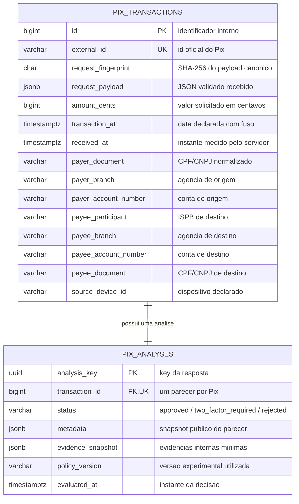

# PIX SENTINEL — ERD v1 | MVP exclusivamente antifraude

> **Documento:** `docs/ERD.md` (proposta v1 para revisão de João e Moha)  
> **Data de elaboração:** 17–18/10/2026  
> **Estado:** `PROPOSTO_PARA_ACEITE` · `MVP_SEM_CORE_BANCARIO` · `POLITICA_NAO_CONGELADA`  
> **Fonte de precedência:** `PIX_SENTINEL_DIRETRIZ_MVP_ANTIFRAUDE_PARA_CODEX_v1.md` (MVP-AF-001), seguida pelo `Desafio Antifraude Pix.pdf`.  
> **Atenção ao Codex:** este documento descreve o **modelo lógico proposto**, não é migração nem comprovação de implementação. Inspecione antes as convenções reais do Base Service. ROTAS e FLUXOS virão na sequência.

## 1. Problema de negócio e limite da responsabilidade

**Problema:** emitir, em poucos segundos, um parecer antifraude explicável (`approved`, `two_factor_required` ou `rejected`) sobre uma solicitação Pix **ainda não executada**, com dados do payload e histórico de tentativas anteriormente recebidas pelo próprio motor. O motor deve equilibrar risco, tempo e fricção, sem afirmar fraude comprovada nem execução bancária.

**Dentro do MVP:** contrato Pix oficial, persistência de tentativas distintas, análise persistida e recuperável, idempotência, consultas históricas por pagador/contraparte, evidências derivadas de **D (payload), H (histórico) e S (servidor)** e metadados de decisão.

**Fora do MVP:** MockServer/core simulado (fonte B), cadastro interno de contas, elegibilidade bancária, consulta/alteração de saldo, limites cadastrais, lançamentos contábeis, débito, reserva, transferência, liquidação e execução real de 2FA. **`rejected` é exclusivamente um parecer antifraude** neste MVP. Dados de conta presentes no Pix são dados *declarados da requisição*, não um cadastro institucional verificado.

## 2. Diagrama ER (Mermaid)



**Cardinalidade lógica:** um Pix distinto deve possuir exatamente uma análise concluída; cada análise pertence a exatamente um Pix. A FK `pix_analyses.transaction_id UNIQUE NOT NULL` garante **no máximo uma** análise por Pix. A obrigatoriedade de terminar com as **duas linhas ou nenhuma** depende de uma única transação de banco, não apenas da cardinalidade do ERD. Em caso de falha, rollback integral.

## 3. Dicionário de dados — `pix_transactions`

| Coluna | Tipo PostgreSQL **proposto** | Regra / origem |
|---|---|---|
| `id` | `BIGINT GENERATED ... AS IDENTITY` | PK técnica interna; **não** substituir o `id` Pix externo |
| `external_id` | `VARCHAR` / `TEXT NOT NULL UNIQUE` | `$.id` do contrato oficial; única no escopo desta implantação |
| `request_fingerprint` | `CHAR(64) NOT NULL` | SHA-256 de JSON **validado e canonizado**, excluindo campos gerados pelo servidor; permite detectar `id` reaproveitado com payload divergente |
| `request_payload` | `JSONB NOT NULL` | Snapshot integral da requisição validada, inclusive campos opcionais; acesso controlado por conter PII |
| `amount_cents` | `BIGINT NOT NULL` | `$.amount`, inteiro em centavos; valor positivo é validação proposta para ROTAS; nunca converter com `float` |
| `transaction_at` | `TIMESTAMPTZ NOT NULL` | `$.transaction_date`, timezone-aware, instante declarado |
| `received_at` | `TIMESTAMPTZ NOT NULL` | Carimbo do servidor, gerado **uma vez** na entrada original; base de velocity e janelas |
| `payer_document` | `TEXT NOT NULL` | `$.source_account.owner.document_number`; normalizar sem perder zeros nem letras de CNPJ alfanumérico |
| `payer_branch` | `TEXT NOT NULL` | `$.source_account.branch`, preservar zeros |
| `payer_account_number` | `TEXT NOT NULL` | `$.source_account.account_number`, preservar zeros |
| `payee_participant` | `TEXT NOT NULL` | `$.destination_account.participant` (ISPB da instituição de destino) |
| `payee_branch` | `TEXT NOT NULL` | `$.destination_account.branch` |
| `payee_account_number` | `TEXT NOT NULL` | `$.destination_account.account_number` |
| `payee_document` | `TEXT NOT NULL` | `$.destination_account.owner.document_number` |
| `source_device_id` | `TEXT NOT NULL` | `$.source.device_id`, origem declarada; não representa dispositivo cadastrado/confiável |

**Por que o JSON e campos derivados?** `request_payload` preserva o contrato completo (`opening_date` de ambos os lados, `source.channel`, `source.ip` e `source.geolocation` opcional) para auditoria e GET, enquanto os campos materializados acima tornam agregações simples/indexáveis sem varrer JSON a cada consulta. Não criar, no v1, tabelas separadas `users`, `accounts`, `devices` ou `counterparties`: o payload não é cadastro bancário verificado e o MVP não precisa dessas relações.

**Semântica de identidade:** o `source_account` **não contém ISPB de origem**. Para histórico por conta pagadora, usar a **chave composta lógica** `(payer_document, payer_branch, payer_account_number)` apenas dentro do escopo desta implantação, reconhecendo que isso **não é uma identidade bancária global certificada**. Para contraparte, usar `(payee_participant, payee_branch, payee_account_number, payee_document)`. Não identificar conta apenas pelo CPF/CNPJ.

## 4. Dicionário de dados — `pix_analyses`

| Coluna | Tipo PostgreSQL **proposto** | Regra / origem |
|---|---|---|
| `analysis_key` | `UUID PRIMARY KEY` | Valor do campo `key` da resposta; gerar na primeira análise e preservar em replay |
| `transaction_id` | `BIGINT UNIQUE NOT NULL` | FK `pix_transactions(id)`; relação 1:1 sem duplicação |
| `status` | `TEXT NOT NULL` | CHECK em `approved`, `two_factor_required`, `rejected` |
| `metadata` | `JSONB NOT NULL` | **Objeto** JSON da resposta armazenado como snapshot, não recalculado no GET |
| `evidence_snapshot` | `JSONB NOT NULL DEFAULT '{}'::jsonb` | Códigos/valores de evidências usadas na decisão, **internos e mínimos**; não vazar no metadata público |
| `policy_version` | `TEXT NOT NULL` | Versão da configuração **experimental** que avaliou o Pix; não indica política congelada |
| `evaluated_at` | `TIMESTAMPTZ NOT NULL` | Momento em que o parecer foi registrado |

**Contrato sugerido de `metadata` (ROTAS decidirá o fechamento):** `reason_code`, `reason_description` breve e `policy_version`. Não devolver score detalhado, limiares sensíveis, CPF/CNPJ, conta, IP, geolocalização ou evidências internas. Não introduzir `banking_eligibility`, nem assumir `push_confirmation`/`facial_liveness` implementados. `two_factor_required` significa **parecer de necessidade de autenticação**, sem executar 2FA.

**Não criar `risk_score` como coluna obrigatória no v1.** O edital exige uma decisão, e o score numérico ainda não foi congelado. Se uma futura política precisar de score persistente, armazenar o valor no `evidence_snapshot` interno ou aprovar migração, evitando coluna especulativa agora.

## 5. Restrições e índices mínimos

### Integridade obrigatória

1. `pix_transactions.id` — PK; `external_id` — `UNIQUE NOT NULL`.
2. `pix_transactions.request_fingerprint` — não nulo; hash **não substitui** unicidade do `external_id`.
3. `pix_analyses.analysis_key` — PK UUID; `transaction_id` — `UNIQUE NOT NULL` e FK para `pix_transactions.id`.
4. `pix_analyses.status` — CHECK dos três estados oficiais; `metadata` e `evidence_snapshot` devem ser objetos JSON (`jsonb_typeof(...) = 'object'`), se PostgreSQL.
5. `amount_cents` e datas corretamente tipados; limite de valor exato e erros HTTP permanecem decisão de ROTAS.
6. Aplicação insere solicitação e parecer em **uma única transação atômica**; impedir resposta de sucesso antes do commit.

### Índices de negócio candidatos

```sql
-- PostgreSQL: exemplos de índices propostos; adaptar ao Base Service.
-- UNIQUE(external_id) e UNIQUE(transaction_id) já criam índices próprios.
CREATE INDEX ix_pix_tx_payer_received
    ON pix_transactions (payer_document, payer_branch, payer_account_number, received_at DESC);

-- Útil para verificar se este destinatário já foi observado para este pagador.
-- Se não houver uso/ganho medido na primeira fatia, pode ser adiado.
CREATE INDEX ix_pix_tx_payer_payee_received
    ON pix_transactions (
        payer_document, payer_branch, payer_account_number,
        payee_participant, payee_branch, payee_account_number, payee_document,
        received_at DESC
    );
```

Não criar índices em `status`, `IP`, `geo` ou `device_id` antecipadamente: dependem de consultas realmente implementadas e medições. Não criar tabelas auxiliares agregadas, caches ou `payer_state` no v1.

## 6. Fluxo transacional mínimo sugerido ao documento FLUXOS

1. Validar o Pix conforme o contrato de ROTAS e obter uma representação canônica estável do payload.
2. Identificar se `external_id` já foi persistido. **Mesmo ID + mesmo fingerprint**: responder com `analysis_key/status/metadata` originais, sem novo registro, sem novo `received_at` e sem somar tentativa ao histórico. **Mesmo ID + fingerprint diferente:** recomendar `409 Conflict` em ROTAS; nunca sobrescrever.
3. Em Pix novo, obter `received_at` do servidor, proteger corrida de inserts por `UNIQUE(external_id)` e definir serialização/locks por pagador no documento FLUXOS se a política de velocity exigir consistência estrita entre Pix distintos concorrentes.
4. Computar histórico usando `(payer_document, payer_branch, payer_account_number)`, `received_at` e **Pix distintos**. Contar o Pix atual **exatamente uma vez**: ou inseri-lo na transação antes da consulta, ou somá-lo explicitamente à agregação; **nunca ambos**.
5. Avaliar poucas regras antifraude de D/H/S, com parâmetros centralizados, versionados e ainda experimentais. Não chamar dado ausente/erro técnico de sinal de fraude.
6. Persistir `pix_transactions` e `pix_analyses` atomicamente. Devolver somente depois do commit; GET deve reconstruir o retorno original da análise persistida, **não** recalcular contra dados/política novos.

**Concorrência — limite de garantia:** `UNIQUE(external_id)` protege a duplicidade de um **mesmo Pix**; não garante por si só contagem serializável de **Pix diferentes do mesmo pagador**. Estratégia concreta (`advisory lock`, serialização transacional etc.) será decidida em FLUXOS, de acordo com o PostgreSQL/ORM reais. Não prometer essa garantia sem implementá-la e testá-la.

**Histórico ≠ liquidação:** `approved`, `rejected` e `two_factor_required` são pareceres sobre tentativas. A soma de `amount_cents` em janelas é **montante solicitado/tentado**, nunca saldo gasto ou dinheiro transferido.

## 7. Exemplos de consultas que o ERD precisa suportar

- **Velocity:** contagem de Pix distintos de um pagador no intervalo `[received_at_atual − janela, received_at_atual]`, com fronteiras exatas definidas em FLUXOS. Consultar no banco, sem carregar todo o histórico em Python.
- **Montante tentado:** soma `amount_cents` dos Pix distintos na janela pelo mesmo agrupamento.
- **Contraparte observada:** existência de Pix anteriores para o mesmo par pagador–destinatário; **observado ≠ confiável**.
- **Cold start:** ausência de tentativas anteriores; isso não significa primeiro Pix da vida nem risco automático.
- **Replay:** encontrar pelo `external_id`, comparar `request_fingerprint` e recuperar por `transaction_id` a análise inalterada.

**Consulta de velocidade ilustrativa** (substituir parâmetros e limite de janela por configuração aprovada; não é threshold já validado):

```sql
SELECT COUNT(*) AS attempted_pix_count,
       COALESCE(SUM(amount_cents), 0) AS attempted_amount_cents
FROM pix_transactions
WHERE payer_document = :payer_document
  AND payer_branch = :payer_branch
  AND payer_account_number = :payer_account_number
  AND received_at >= :window_start
  AND received_at <= :received_at_current;
```

> Essa consulta só é correta se o controle de concorrência e a inclusão do Pix corrente seguirem a convenção definida em FLUXOS. Uma transação atômica do Pix atual não implica, sozinha, consistência serializável para vários Pix distintos concorrentes.

## 8. Mapeamento ao contrato oficial e decisões reservadas

| Elemento do edital / MVP | Materialização no ERD | Decisão ainda para ROTAS/FLUXOS |
|---|---|---|
| `POST /pix/transaction`, `id` | `pix_transactions.external_id` + payload original | DTOs, validações, erro HTTP e semântica de replay |
| `amount` em centavos | `amount_cents BIGINT` | limites de aceitação/erro por valor inválido |
| `transaction_date` com fuso | `transaction_at TIMESTAMPTZ` e original no JSON | validação de fuso, datas futuras/anômalas |
| `source.geolocation` opcional | preservado somente em `request_payload` | presença/ausência e validação |
| Origem sem ISPB | chave composta escopada por serviço | limitações de identidade e cobertura |
| `destination_account.participant` | `payee_participant` | normalização do identificador |
| Resposta `key/status/metadata` | `pix_analyses` (snapshot) | formato exato do metadata e status HTTP |
| `GET /pix/transaction/{id}` | join `external_id` → análise ou busca pela `analysis_key` | **definir o significado de `{id}` em ROTAS**; não assumir terceiro endpoint |
| Histórico persistido | `pix_transactions` + índices | fronteiras de janela e concorrência |
| Padrões Base Service | tipos/migração/ORM ainda não escritos | **inspecionar repositório antes de codificar** |

## 9. Trade-offs de modelagem (v1)

**Por que duas tabelas e não dez?** A separação entre solicitação recebida e parecer permite recuperar snapshot imutável e raciocinar sobre idempotência sem criar entidades fictícias. Nenhuma tabela de titular, conta, dispositivo, pagamento, biometria, score ou motor genérico é necessária.

**Por que não uma única tabela?** Também seria viável para um MVP extremamente simples. Duas tabelas separam a requisição (fonte histórica) da análise (resultado) e acomodam política versionada/evidência interna, com custo de um join. Se o Base Service sugerir inequivocamente outro padrão, registrar a alternativa antes de mudar.

**Por que poucos índices?** O primeiro índice favorece velocity e montante por pagador; o segundo é opcional quando a busca por contraparte for implementada. Duplicar índices não substitui benchmark real.

**Privacidade:** o contrato exige histórico, mas armazenar documentos/IP/geolocalização é sensível. Aplicar acesso restrito, não registrar payload completo em logs, não devolver `request_payload`/`evidence_snapshot` no GET público, definir retenção e minimização conforme o projeto. `request_fingerprint` deve ser hash de bytes canônicos estáveis e **não** ser exposto publicamente; ele não garante anonimização dos dados.

## 10. Verificações de aceite do ERD e handoff para Codex

- [ ] João e Moha aprovam o recorte de **duas entidades** e a separação do parecer.
- [ ] Conferir se o Base Service usa PostgreSQL e quais convenções de PK, migrations, ORM e timestamps existem.
- [ ] ROTAS define `{id}` de GET, payload canônico, status HTTP e 409 de conflito.
- [ ] FLUXOS define fronteira de janelas, se o Pix atual é lido após insert ou somado em memória, e concorrência por pagador.
- [ ] Confirmar quais regras simples entrarão na primeira fatia; pesos/thresholds **não** estão congelados.
- [ ] Na implementação: testar POST/GET, payload opcional, centavos/fuso, replay igual e divergente, consulta histórica, rollback de falha e privacidade.

**Instrução curta para o Codex:** leia primeiro `MVP-AF-001` e este ERD. **Não recrie B/mock ou critérios de elegibilidade.** Não crie migrações ou código ainda sem inspecionar Base Service e sem receber ROTAS e FLUXOS. Quando a equipe aprovar os três, implemente duas entidades pequenas, índices necessários, transação atômica, snapshot e testes TDD incrementais. Use configuração de política experimental, sem importar thresholds da Etapa 4 como definitivos.

---

## Referências de controle

- `Desafio Antifraude Pix.pdf`, seções 2–6: contrato, três decisões, POST/GET, persistência, Base Service, README e poucos segundos.
- `PIX_SENTINEL_DIRETRIZ_MVP_ANTIFRAUDE_PARA_CODEX_v1.md`: escopo vinculante atual, exclusivamente antifraude; remove B e elegibilidade.
- `PIX_SENTINEL_ETAPA_5_DIRETRIZES_PRE_IMPLEMENTACAO_SEM_CONGELAMENTO_v1.md`: histórico de planejamento **anterior à mudança de escopo**; não usar suas propostas de core bancário no MVP.

**Condição do documento:** desenho lógico para deliberação, **não migração implementada, não teste funcional da API e não política numérica congelada**.
