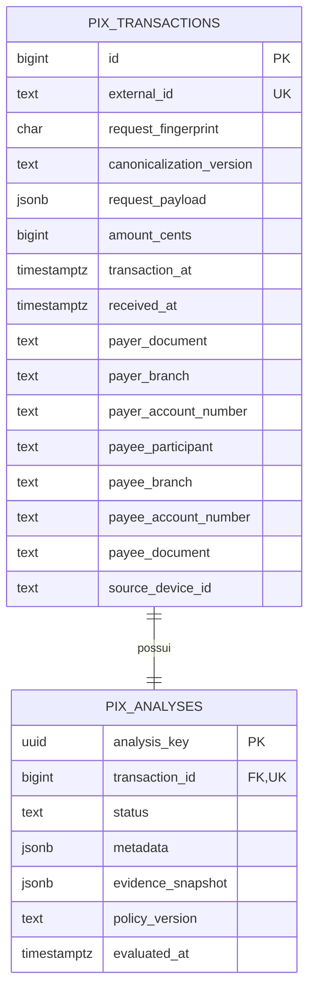

# PIX SENTINEL — modelo de dados vigente

**Atualizado em:** 18/10/2026
**Fonte de verdade:** `database/database.sql` e modelos de `src/models/`

O modelo possui duas entidades. `pix_transactions` registra a tentativa e
fornece o histórico local; `pix_analyses` guarda o parecer imutável. As duas
linhas são criadas na mesma transação de banco.

## Diagrama

## `pix_transactions`

| Coluna | Tipo | Origem e finalidade |
|---|---|---|
| `id` | `BIGINT IDENTITY` | Chave técnica interna. |
| `external_id` | `TEXT NOT NULL UNIQUE` | Campo `id` da entrada; base do GET e da idempotência. |
| `request_fingerprint` | `CHAR(64) NOT NULL` | SHA-256 da representação canônica dos campos oficiais. |
| `canonicalization_version` | `TEXT NOT NULL` | Hoje `pix-official-v1`; permite evoluir o canonizador. |
| `request_payload` | `JSONB NOT NULL` | Snapshot integral recebido e validado, inclusive campos extras aceitos pelo schema. |
| `amount_cents` | `BIGINT NOT NULL` | Valor tentado em centavos; possui `CHECK > 0`. |
| `transaction_at` | `TIMESTAMPTZ NOT NULL` | Horário declarado pelo cliente, obrigatoriamente com fuso. |
| `received_at` | `TIMESTAMPTZ NOT NULL` | Relógio do PostgreSQL depois do lock; base das janelas. |
| `payer_document` | `TEXT NOT NULL` | Documento declarado da origem. |
| `payer_branch` | `TEXT NOT NULL` | Agência de origem, preservando zeros. |
| `payer_account_number` | `TEXT NOT NULL` | Conta de origem, preservando zeros. |
| `payee_participant` | `TEXT NOT NULL` | Participante/ISPB declarado do destino. |
| `payee_branch` | `TEXT NOT NULL` | Agência de destino. |
| `payee_account_number` | `TEXT NOT NULL` | Conta de destino. |
| `payee_document` | `TEXT NOT NULL` | Documento declarado do recebedor. |
| `source_device_id` | `TEXT NOT NULL` | Device declarado, materializado para consultas. |

A identidade local do pagador é a tupla `(payer_document, payer_branch,
payer_account_number)`. Como o contrato não traz participante da origem, ela
não é uma identidade bancária global. A contraparte é a tupla
`(payee_participant, payee_branch, payee_account_number, payee_document)`.

## `pix_analyses`

| Coluna | Tipo | Regra |
|---|---|---|
| `analysis_key` | `UUID PRIMARY KEY` | Campo público `key`, criado uma vez. |
| `transaction_id` | `BIGINT UNIQUE NOT NULL` | FK para `pix_transactions.id`; garante no máximo uma análise por tentativa. |
| `status` | `TEXT NOT NULL` | `CHECK` em `approved`, `two_factor_required` ou `rejected`. |
| `metadata` | `JSONB NOT NULL` | Snapshot público; deve ser objeto JSON. |
| `evidence_snapshot` | `JSONB NOT NULL` | Evidências, score e sinais internos; deve ser objeto JSON. |
| `policy_version` | `TEXT NOT NULL` | Política que produziu a decisão. |
| `evaluated_at` | `TIMESTAMPTZ NOT NULL` | Horário UTC de criação da análise. |

O GET lê `analysis_key`, `status` e `metadata`; não recalcula o risco e não
expõe `request_payload`, fingerprint ou evidências internas.

## Índices reais

Além dos índices criados pelas chaves primárias e restrições únicas, o schema
possui:

| Índice | Colunas/expressão | Uso principal |
|---|---|---|
| `ix_pix_transactions_payer_received_at` | pagador + `received_at` | Janelas, perfil e contraparte do pagador. |
| `ix_pix_transactions_payee_received_at` | recebedor + `received_at` | Observação global e fan-in do beneficiário. |
| `ix_pix_transactions_device_received_at` | `source_device_id`, `received_at` | Familiaridade e compartilhamento de device. |
| `ix_pix_transactions_source_ip_received_at` | IP extraído do JSONB + `received_at` | Familiaridade e compartilhamento de IP. |

## Invariantes transacionais

- `external_id` é a autoridade final contra duplicação do mesmo Pix.
- Mesmo `external_id` com fingerprint igual devolve a análise existente.
- Mesmo `external_id` com fingerprint diferente não altera dados e retorna
  `409`.
- Tentativa e análise são confirmadas por um único commit; uma falha anterior
  provoca rollback.
- As janelas `(T − W, T]` incluem a linha atual uma vez; contagens “prior” usam
  `id != current.id`.
- `amount_cents` representa valor tentado, não saldo debitado ou Pix liquidado.

## Fingerprint e campos extras

O canonizador `pix-official-v1` usa somente os campos oficiais, ordena as chaves,
normaliza timestamps para UTC, normaliza a representação numérica de latitude e
longitude e considera geolocalização ausente equivalente a `null`. Campos
extras são aceitos pelo JSON Schema e preservados em `request_payload`, porém
não mudam o fingerprint nem a decisão. Portanto, uma repetição que altere
somente um campo extra é tratada como replay e devolve o primeiro snapshot.

## Privacidade e limites

Payload, documentos, conta, IP e coordenadas são dados sensíveis. Eles ficam no
banco para auditoria e cálculo, mas não aparecem no DTO público nem nos logs de
requisição. O snapshot derivado guarda estados, contagens, distância e
velocidade, sem copiar IPs ou coordenadas. Retenção, criptografia e controle de
acesso de produção permanecem decisões de implantação.

`database/database.sql` inicializa bancos novos. Os arquivos `002`, `003` e
`004` são atualizações incrementais manuais para bancos já existentes; não são
executados automaticamente pelo Docker em volumes previamente inicializados.
