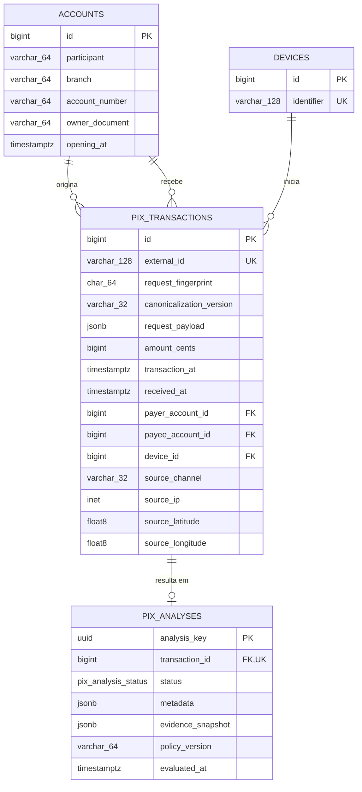

# PIX SENTINEL — modelo de dados vigente

**Atualizado em:** 18/10/2026
**Fonte de verdade:** `database/database.sql` e `src/models/`

O modelo possui quatro entidades: conta, dispositivo, tentativa Pix e análise.
Conta e dispositivo são reutilizados entre eventos; a tentativa guarda o fato
transacional e a análise preserva a decisão imutável. A criação ou reutilização
das identidades, a tentativa e a análise ocorrem na mesma transação de banco.

## Diagrama

No diagrama, `PIX_TRANSACTIONS ||--o| PIX_ANALYSES` representa corretamente a
restrição do banco: uma tentativa pode ter zero ou uma análise, enquanto toda
análise pertence exatamente a uma tentativa. No fluxo normal, controller e
repositório criam as duas linhas na mesma transação e só respondem após o
commit; a obrigatoriedade operacional não é fingida como cardinalidade SQL.

As quatro colunas de `accounts` também **não são únicas isoladamente**. A
restrição é composta por `(participant, branch, account_number,
owner_document)`, como detalhado abaixo.

## `accounts`

| Coluna | Tipo | Finalidade |
|---|---|---|
| `id` | `BIGINT IDENTITY` | Chave técnica referenciada pelas transações. |
| `participant` | `VARCHAR(64)` | Participante/ISPB quando informado; é `NULL` na origem porque o contrato não o fornece. |
| `branch` | `VARCHAR(64) NOT NULL` | Agência como identificador, preservando zeros à esquerda. |
| `account_number` | `VARCHAR(64) NOT NULL` | Conta como identificador, preservando zeros à esquerda. |
| `owner_document` | `VARCHAR(64) NOT NULL` | Documento normalizado: sem `.`, `-`, `/` ou espaços e em maiúsculas. |
| `opening_at` | `TIMESTAMPTZ NOT NULL` | Data de abertura declarada no contrato. |

A identidade local é a combinação única `(participant, branch,
account_number, owner_document)`, com `NULLS NOT DISTINCT`. Isso permite
reutilizar a mesma conta de origem mesmo com `participant = NULL`. Como o
contrato não informa o participante da origem, uma conta observada ora como
pagadora e ora como recebedora pode permanecer em identidades locais distintas;
o sistema não inventa um ISPB ausente. Se a mesma identidade reaparecer com
outra data de abertura, prevalece a primeira observação persistida.

## `devices`

| Coluna | Tipo | Finalidade |
|---|---|---|
| `id` | `BIGINT IDENTITY` | Chave técnica referenciada pelas transações. |
| `identifier` | `VARCHAR(128) NOT NULL UNIQUE` | Identificador de device declarado no payload. |

O device é uma entidade própria porque o mesmo identificador pode aparecer em
vários eventos e pagadores. Isso permite medir familiaridade, churn e
compartilhamento sem repetir texto em cada consulta. Não existe um atributo
`fraudulent`: um device compartilhado é evidência contextual, não prova
permanente de fraude.

## `pix_transactions`

| Coluna | Tipo | Finalidade |
|---|---|---|
| `id` | `BIGINT IDENTITY` | Chave técnica interna. |
| `external_id` | `VARCHAR(128) NOT NULL UNIQUE` | Campo `id` da entrada; base do GET e da idempotência. |
| `request_fingerprint` | `CHAR(64) NOT NULL` | SHA-256 da representação canônica dos campos oficiais. |
| `canonicalization_version` | `VARCHAR(32) NOT NULL` | Versão do canonizador usada no replay. |
| `request_payload` | `JSONB NOT NULL` | Envelope original validado para auditoria, campos extras e replay legado. |
| `amount_cents` | `BIGINT NOT NULL` | Valor tentado em centavos, com `CHECK > 0`. |
| `transaction_at` | `TIMESTAMPTZ NOT NULL` | Horário declarado pelo cliente, obrigatoriamente com fuso. |
| `received_at` | `TIMESTAMPTZ NOT NULL` | Relógio do PostgreSQL depois do lock; base das janelas. |
| `payer_account_id` | `BIGINT NOT NULL` | FK `RESTRICT` para a conta pagadora. |
| `payee_account_id` | `BIGINT NOT NULL` | FK `RESTRICT` para a conta recebedora. |
| `device_id` | `BIGINT NOT NULL` | FK `RESTRICT` para o device. |
| `source_channel` | `VARCHAR(32) NOT NULL` | Canal materializado para familiaridade e mudança de acesso. |
| `source_ip` | `INET NOT NULL` | IPv4/IPv6 validado e normalizado pelo tipo nativo do PostgreSQL. |
| `source_latitude` | `DOUBLE PRECISION` | Latitude opcional, entre -90 e 90. |
| `source_longitude` | `DOUBLE PRECISION` | Longitude opcional, entre -180 e 180. |

Latitude e longitude são nulas juntas. Os campos estruturados usados nas
consultas antifraude não são lidos do JSONB. `request_payload` continua de
propósito: ele preserva o contrato recebido e viabiliza replay de registros de
versões anteriores, mas não é a fonte dos agregados históricos.

O IP permanece em `pix_transactions`, e não em `devices`, porque é uma
característica da sessão: um device pode trocar de rede e vários devices podem
usar o mesmo NAT. Movê-lo para `devices` perderia o histórico de troca de IP e
criaria uma relação falsa de um IP fixo por aparelho.

## `pix_analyses`

| Coluna | Tipo | Regra |
|---|---|---|
| `analysis_key` | `UUID PRIMARY KEY` | Campo público `key`, criado uma vez. |
| `transaction_id` | `BIGINT UNIQUE NOT NULL` | FK `RESTRICT`; garante uma análise por tentativa. |
| `status` | `pix_analysis_status NOT NULL` | Enum: `approved`, `two_factor_required` ou `rejected`. |
| `metadata` | `JSONB NOT NULL` | Snapshot público, restrito a objeto JSON. |
| `evidence_snapshot` | `JSONB NOT NULL` | Evidências, score e sinais internos, restritos a objeto JSON. |
| `policy_version` | `VARCHAR(64) NOT NULL` | Política que produziu a decisão. |
| `evaluated_at` | `TIMESTAMPTZ NOT NULL` | Horário UTC da análise. |

O GET lê a análise persistida e não recalcula o risco. Payload, fingerprint e
evidências internas não são expostos pelo DTO público.

`request_fingerprint` e `canonicalization_version` não são variáveis do score.
Elas existem para distinguir replay idêntico de reutilização conflitante do
mesmo `external_id`; sem ambas, uma mudança futura no canonizador poderia tornar
a idempotência ambígua.

## Índices reais

Além das PKs e restrições únicas:

| Índice | Colunas | Uso principal |
|---|---|---|
| `ix_pix_transactions_payer_received_at` | `payer_account_id`, `received_at` | Janelas, perfil e contrapartes do pagador. |
| `ix_pix_transactions_payee_received_at` | `payee_account_id`, `received_at` | Observação global e fan-in do recebedor. |
| `ix_pix_transactions_device_received_at` | `device_id`, `received_at` | Familiaridade e compartilhamento de device. |
| `ix_pix_transactions_source_ip_received_at` | `source_ip`, `received_at` | Familiaridade e compartilhamento de IP. |

## Invariantes transacionais

- `external_id` é a autoridade final contra duplicação do mesmo Pix.
- Mesmo `external_id` e fingerprint devolve a análise existente; conteúdo
  oficial diferente retorna `409`.
- Conta e device são criados com upsert concorrente antes da tentativa.
- Identidades, tentativa e análise são confirmadas por um commit único; falha
  anterior provoca rollback integral.
- As janelas `(T − W, T]` incluem a linha atual uma vez; contagens anteriores
  usam `id != current.id`.
- `amount_cents` é valor tentado, não saldo debitado nem Pix liquidado.

## Fingerprint, privacidade e migração

O canonizador `pix-official-v1` usa apenas os campos oficiais, ordena chaves e
normaliza timestamps e coordenadas. Campos extras ficam no payload de auditoria,
mas não alteram fingerprint ou decisão.

Payload, documentos, conta, IP e coordenadas são dados sensíveis. Eles não
aparecem no DTO nem nos logs; o snapshot derivado não copia IP ou coordenadas.
Retenção, criptografia e controle de acesso são decisões de implantação.

`database/database.sql` inicializa bases novas. Para uma base criada pelo
modelo anterior, `database/005_normalize_accounts_devices_and_types.sql` faz o
backfill das entidades, converte os tipos, recria os índices e remove as colunas
duplicadas. É uma migração manual: requer backup, validação prévia dos IPs
históricos e janela de manutenção.
