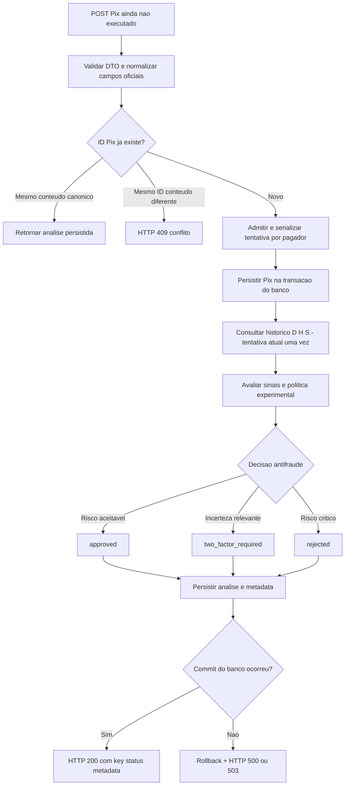
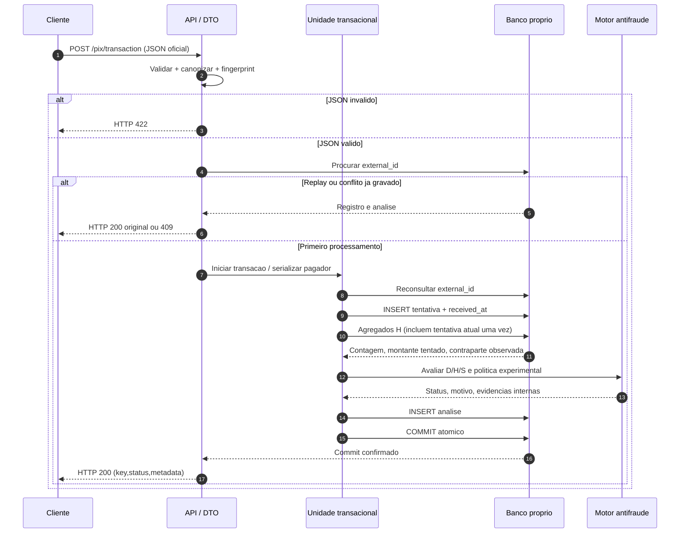
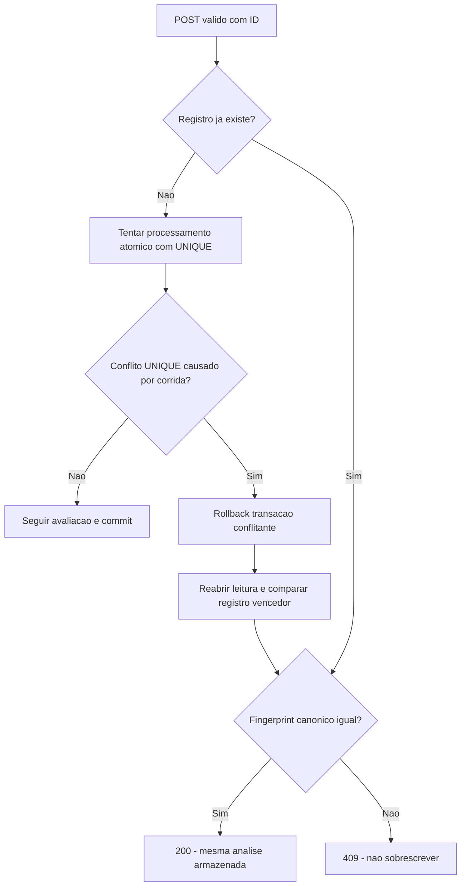
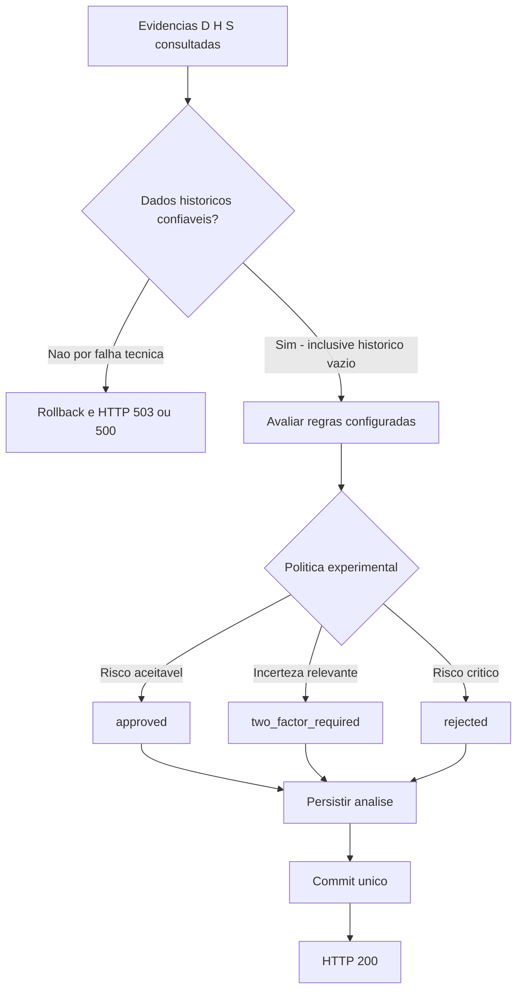
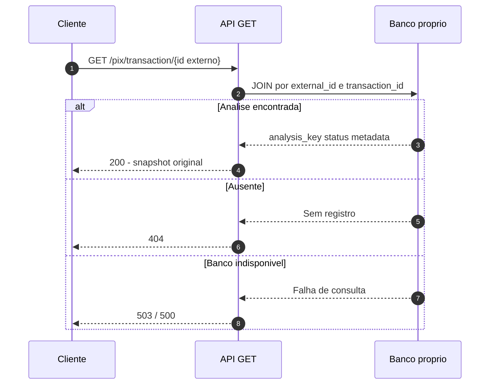

# PIX SENTINEL — FLUXOS v1 | MVP exclusivamente antifraude

> **Artefato proposto:** `docs/FLUXOS.md` · **Versão:** 1.0 · **Estado:** `PROPOSTO_PARA_ACEITE`  
> **Finalidade:** especificação de orquestração do POST/GET, idempotência, contagem histórica, concorrência e falhas, pronta para orientar o Codex **após inspecionar o Base Service**.  
> **Escopo vigente:** `PIX_SENTINEL_DIRETRIZ_MVP_ANTIFRAUDE_PARA_CODEX_v1.md` → `PIX_SENTINEL_ERD_v1.md` → `PIX_SENTINEL_ROTAS_v1.md` + OpenAPI 3.1 → **este documento**. O edital oficial prevalece para o contrato obrigatório.  
> **ATENÇÃO:** proposta documental, **não implementação, teste executado, política de risco congelada ou aceite formal de João e Moha**. A ADR antiga de saldo/core **não governa** o MVP.

## 1. O problema que o fluxo resolve

**Antes da execução de um Pix**, emitir em poucos segundos um parecer **exclusivamente antifraude**, com base em **D** (JSON oficial validado), **H** (tentativas distintas observadas pelo PIX SENTINEL) e **S** (relógio do servidor), minimizando fricção desnecessária. O motor **não** consulta saldo, verifica limite/estado bancário, cadastra contas, executa Pix ou autenticação, confirma fraude, reserva ou movimenta dinheiro.



**O resultado `rejected` é exclusivamente de risco antifraude.** `two_factor_required` expressa uma recomendação de verificação adicional, não autenticação realizada. `approved` não autoriza liquidação. Falha técnica não gera parecer fictício.

## 2. Contratos e invariantes que os fluxos não podem quebrar

| Elemento | Decisão v1 | Origem |
|---|---|---|
| `POST /pix/transaction` | `200` para uma análise concluída, inclusive `rejected`; payload do edital | ROTAS v1 |
| `GET /pix/transaction/{id}` | `{id}` = **ID externo** do Pix, não UUID de análise | ROT-01 |
| Resposta pública | **Somente** `key`, `status`, `metadata` como campos principais; `status` nos três literais oficiais | Edital + ROTAS |
| Modelo persistido | `pix_transactions` (tentativa) + `pix_analyses` (parecer) | ERD v1 |
| Corretude de replay | Mesmo `id` e mesma visão oficial canônica → **mesma resposta**, sem evento adicional | ROT-02 |
| Colisão | Mesmo `id` e conteúdo diferente → `409`; nada sobrescrito | ROT-02 |
| Timestamp | `transaction_at` declarado com fuso ≠ `received_at` controlado pelo servidor | ERD / ROTAS |
| Identidade pagadora | `(payer_document, payer_branch, payer_account_number)` no escopo local; **não há ISPB de origem** | ERD |
| Identidade recebedora | `(payee_participant, payee_branch, payee_account_number, payee_document)` | ERD |
| Histórico | Solicitações/tentativas distintas, **não** transferências liquidadas nem fraude comprovada | Edital / escopo |
| Idempotência/atomicidade | `UNIQUE(external_id)` + `UNIQUE(transaction_id)` + uma transação de BD para tentativa+análise | ERD |
| Disponibilidade | Histórico indisponível ≠ zero histórico; falha infra ≠ risco de fraude | Diretriz MVP |
| Privacidade | Não publicar documento, conta, IP, geo, score, limiar interno ou `evidence_snapshot`; sem payload em logs | ROTAS |

Nenhum fluxo depende de mock bancário ou de dados internos como `available_balance_cents`, `account_status`, `registered_devices`, `pix_limits` ou `onboarding_geolocation`. O `metadata` do MVP **não inclui** `banking_eligibility` nem desafios biométricos/push simulados.

## 3. Fluxo F01 — POST novo: validação, histórico, parecer e commit

### Ordem de operações proposta

1. Receber JSON e validar o contrato oficial: `amount` inteiro estrito positivo em centavos; `transaction_date` e `opening_date` com fuso; documentos/contas como strings; destino com `participant`; `source.geolocation` ausente ou `null` permitido. Rejeitar estrutura inválida com HTTP `422`, **sem gravação**.
2. Produzir DTO oficial normalizado e **fingerprint SHA-256 canônico**: incluir apenas campos oficiais validados, fixar serialização, normalização e fusos, tornar geo ausente e `null` equivalentes, não usar campos calculados. É hash para replay, não proteção de PII.
3. Buscar análise existente por `external_id`. Se houver, comparar fingerprint e seguir para **F02**; lookup inicial é só otimização, **não substitui `UNIQUE`**.
4. Iniciar transação de banco e, se a estratégia suportar, **serializar por identidade pagadora** antes de agregar H. Reconsultar `external_id` dentro da seção serializada (e conferir corrida de `UNIQUE` mesmo entre pagadores diferentes).
5. Para a **tentativa original nova**, atribuir `received_at` uma única vez na admissão transacional serializada, criar `pix_transactions` com `request_payload` oficial e campos denormalizados do ERD; efetuar *flush* na mesma transação (a linha ainda não fica visível a outras transações até commit).
6. Consultar agregados SQL por pagador, `received_at` e intervalo da política experimental; a consulta **inclui a nova linha inserida exatamente uma vez**, sem somar `+1` ou o `amount` em Python. Consultas de contraparte habitual excluem explicitamente o Pix atual.
7. Avaliar sinais de `D + H + S` e produzir um parecer antifraude conforme **configuração experimental versionada**; guardar evidência mínima interna e motivo público genérico, sem parâmetros sensíveis. **Não** consultar saldo, conta bloqueada nem core externo.
8. Inserir `pix_analyses` com UUID `analysis_key`, `status`, `metadata` objeto, `evidence_snapshot` objeto, `policy_version`, `evaluated_at`; garantir uma análise por `transaction_id`.
9. **Fazer commit da transação única antes de devolver HTTP 200.** Se qualquer passo até o commit falhar, fazer rollback integral; não deixar Pix órfão ou análise parcial. Após commit, devolver `{key, status, metadata}` persistidos.



**Fronteira essencial:** a persistência da solicitação e do parecer é *atômica*. Uma execução não pode ter `200` se houver somente linha em `pix_transactions` ou somente linha em `pix_analyses`.

## 4. Fluxo F02 — replay, conflito e crash após commit

| Caso | Comportamento exigido | Retorno |
|---|---|---|
| Mesmo `id`, mesmo conteúdo oficial canônico | Retornar o **snapshot** da análise existente, sem recalcular risco nem alterar histórico/versão/timestamps | HTTP `200` com JSON idêntico |
| Mesmo `id`, payload canônico diferente | Não atualizar ou substituir nenhum dado; não vazar diferenças sensíveis | HTTP `409`, `PIX_ID_CONFLICT` |
| Reenvio quando política atual mudou | **Continuar usando política, motivo e `key` originais** | HTTP `200` original |
| Processo caiu **após commit** e antes da resposta | Cliente reenvia; banco já contém a análise; retornar snapshot original | HTTP `200` original |
| Processo caiu **antes de commit** | Rollback/ausência das duas linhas; reenvio poderá ser tratado como novo | Processar normalmente |



**Concorrência de mesmo ID:** caso duas requisições cheguem juntas, a restrição única do BD é a **autoridade final**. Quando o segundo `INSERT` encontrar duplicidade, não devolver `500` automaticamente: encerrar/rollback da tentativa conflitante, ler o registro vencedor após concluir a corrida e comparar fingerprints. Se o vencedor ainda não comitou, aguardar conforme o mecanismo de unicidade/transação do BD; aplicar timeout limitado. Se houver aborto do vencedor, efetuar no máximo uma repetição controlada de processamento. Se a recuperação não for conclusiva, retornar falha técnica sem duplicar análise.

## 5. Fluxo F03 — velocity, montante e contraparte: definições operacionais

### Fonte, contagens e janela

- **Relógio:** usar `received_at` do servidor, não `transaction_date` autodeclarado, para janelas de atividade. Normalizar comparações temporais para instantes UTC.
- **Janela candidata:** intervalo **`(T − W, T]`**, com início exclusivo e fim inclusivo. `T` é `received_at` da tentativa atual, e `W` vem de **configuração experimental**, não de um limite congelado. Usar esta fronteira como **convenção técnica proposta**; se as especificações anteriores tinham `[T−W,T]`, esta escolha exige aceite e atualização conjunta antes do código.
- **Contagem:** agregar apenas Pix distintos porque cada `external_id` aparece uma vez; incluir a linha **atual uma vez**, inserida antes da consulta. O total observado na primeira transação do pagador será 1, sem afirmar que é o primeiro Pix real daquele cliente.
- **Montante:** `SUM(amount_cents)` de tentativas distintas na janela, inclusive `approved`, `two_factor_required` e `rejected` anteriores. Esse valor é **tentado**, não transferido.
- **Contraparte já observada:** consulta de existência de **outro Pix anterior** do mesmo pagador para a mesma chave do recebedor, excluindo a tentativa atual. Não classificar a contraparte como legítima nem fraudulenta por isso.
- **Qualidade:** sem linhas anteriores é histórico válido vazio; banco inacessível, consulta falha ou dado inválido são **erro/indisponibilidade**, não zeros fictícios. Não atribuir automaticamente risco alto a primeiro Pix/geo ausente.
- **Agrupamento:** chave do pagador `(payer_document, payer_branch, payer_account_number)`, apenas no escopo local; não usar documento isolado nem inventar ISPB pagador. Contraparte inclui `participant` de destino.

```sql
-- SQL conceitual: executado DENTRO da mesma transacao, apos INSERT do Pix atual.
-- Janela proposta: (T-W, T]; T/W sao parametros; indexes do ERD.
SELECT COUNT(*) AS attempted_pix_count,
       COALESCE(SUM(amount_cents), 0) AS attempted_amount_cents
FROM pix_transactions
WHERE payer_document = :payer_document
  AND payer_branch = :payer_branch
  AND payer_account_number = :payer_account_number
  AND received_at > :window_start
  AND received_at <= :received_at_current;

-- Novo destinatario no historico do pagador: EXCLUIR a transacao atual.
SELECT EXISTS (
    SELECT 1 FROM pix_transactions
    WHERE payer_document = :payer_document
      AND payer_branch = :payer_branch
      AND payer_account_number = :payer_account_number
      AND payee_participant = :payee_participant
      AND payee_branch = :payee_branch
      AND payee_account_number = :payee_account_number
      AND payee_document = :payee_document
      AND id <> :current_transaction_pk
) AS payee_previously_observed;
```

**Performance:** usar `COUNT`, `SUM`, `EXISTS` e índices SQL; não carregar todas as operações para Python. Não fazer score duplicado porque uma mesma rajada disparou várias janelas. Os números dos limites de decisão permanecem **provisórios**.

### Concorrência por pagador — proposta F03-C

**Problema:** `UNIQUE(external_id)` evita duplicação do *mesmo Pix*, mas **não evita** que duas transações distintas do mesmo pagador consultem H simultaneamente e ambas vejam a mesma contagem antiga.

**Recomendação se Base Service usar PostgreSQL:** usar um **advisory lock transacional por chave canônica do pagador** (por exemplo `pg_advisory_xact_lock` com hash estável de documento+agência+conta, escopado à aplicação), adquirido **antes de inserir/consultar H** e liberado automaticamente no commit/rollback. A chave deve ter serialização inequívoca (não concatenar strings sem delimitador de tamanho). Colisões de hash, se ocorrerem, apenas serializam pagadores independentes, sem misturar históricos. Usar `READ COMMITTED` com consultas feitas após o lock, ou estratégia equivalente cuja visibilidade seja efetivamente testada.

**Detalhe temporal a confirmar (FLW-DEC-01):** para obter uma ordem coerente entre operações do mesmo pagador, proponho que `received_at` seja o instante em que o servidor **admite a tentativa inédita para a avaliação serializada**, capturado **depois** de adquirir o lock. Isso mantém uma única coluna de tempo e uma única linha por Pix. É um refinamento da expressão anterior “recebido no servidor”: se vocês exigirem o instante exato da chegada HTTP **antes** da espera pelo lock, essa data poderá divergir da ordem de avaliação e será necessário documentar a limitação ou propor outro campo/esquema (o que **não** devemos fazer silenciosamente no v1).

**Se não houver PostgreSQL/advisory lock no Base Service:** o Codex deve **identificar o banco real e apresentar alternativa mínima comprovável** (transações serializáveis com retry, lock por chave persistente ou serialização coordenada equivalente). Mutex apenas em memória **não garante** correção entre múltiplos workers. Não fingir garantia de concorrência até executar o teste de dois Pix distintos simultâneos.

**Trade-off:** serializar por pagador pode aumentar a latência sob rajadas. Medir p50/p95 com concorrência; timeout/lock fail gera **falha técnica 503**, jamais decisão `rejected` por causa do lock.

## 6. Fluxo F04 — decisão antifraude e três caminhos de saída

| Contexto | Status possível | Motivo genérico ilustrativo | Comportamento |
|---|---|---|---|
| Evidência disponível com risco aceitável na política experimental | `approved` | `RISK_ACCEPTED` | Persistir; sem executar Pix |
| Evidência incerta que justifica fricção proporcional | `two_factor_required` | `ADDITIONAL_VERIFICATION` | Persistir recomendação; **não** executar 2FA, push ou liveness |
| Conjunto de evidências de risco crítico conforme política configurada | `rejected` | `CRITICAL_FRAUD_RISK` | Persistir parecer; **não** alegar fraude comprovada |

A escolha numérica do status **não está congelada**: implementação inicial pode usar uma política determinística pequena, com parâmetros externos, nomes/versionamento claros e testes de exemplos explícitos. Não importar pesos/limites do laboratório da Etapa 4 sem nova aprovação. Não devolver score detalhado/limiares no `metadata` público. `evidence_snapshot` é interno, não incluído no GET.



### `metadata` público — exemplo não congelado

```json
{
  "key": "b3f1c2e0-7d4a-4c1e-9a52-1f0e6c9d2a77",
  "status": "two_factor_required",
  "metadata": {
    "schema_version": "1.0",
    "policy_version": "dev-config-001",
    "reason_code": "ADDITIONAL_VERIFICATION",
    "reason_description": "Verificacao adicional recomendada pela politica antifraude."
  }
}
```

`dev-config-001` é **exemplo**, não versão aprovada. Não incluir campos bancários, documentos, IP, coordenadas, biometria ou desafios que o sistema não realiza.

## 7. Fluxo F05 — GET: leitura do snapshot imutável

1. Receber `GET /pix/transaction/{id}` (`id` é **external_id** de `POST`, não `analysis_key`).
2. Buscar `pix_transactions.external_id`, fazer join com `pix_analyses` e recuperar o snapshot **público** `{analysis_key→key, status, metadata}`.
3. Encontrou: HTTP `200`, **dados iguais aos da resposta POST original**; não executar regras, gerar UUID ou consultar histórico atual.
4. Não encontrou: HTTP `404`, corpo sanitizado no padrão ROTAS/Base Service.
5. Banco indisponível: HTTP `503` (ou `500` quando falha interna não classificada); **não retornar 404 por indisponibilidade**.



## 8. Fluxo F06 — falhas, rollback e segurança

| Falha / condição | Regra de fluxo | HTTP externo (proposto) |
|---|---|---|
| JSON inválido, `amount` float/string/bool/zero/negativo, datas sem fuso | Falha antes da persistência | `422` |
| Mesmo ID com payload diferente | Sem modificação da análise original | `409` |
| GET não encontrado | Consulta válida, sem registro | `404` |
| Falha durante INSERT ou INSERT da análise / commit | Rollback integral; nunca `200` parcial | `500`/`503` conforme causa |
| Banco/consulta H indisponível | Não inventar histórico zero ou `rejected` | `503` |
| Timeout de lock/deadlock ou falha de serialização | Retry bounded se seguro; senão falha técnica; não gerar outro Pix | `503` (ou convenção do Base Service) |
| Falha de regra inesperada | Não gravar parecer arbitrário; rollback e log sanitizado | `500` |
| Replay após commit com resposta perdida | Ler decisão persistida; mesma resposta | `200` |
| Geo opcional ausente | Prosseguir, sem penalidade isolada | `200` após avaliação |

**Privacidade operacional:** não logar documento/conta/IP/geo ou payload integral em claro; `fingerprint` não substitui proteção de dados. Logs devem priorizar correlação técnica e classe de falha, sem exposição pública de segredos, limiares ou rastros de risco. `metadata` externo sempre seguro e imutável.

## 9. Plano de implementação para Codex: fatias pequenas e TDD essencial

**Antes de escrever código:** inspecionar Base Service real: banco/ORM, migrações, rotas, tratamento de `IntegrityError`, unidade transacional, testes existentes. Não gerar um novo projeto paralelo nem supor PostgreSQL sem verificar. Se conflito com padrão do template, apresentar mudança mínima e justificá-la.

| Fatia | Entrega verificável | IDs de teste da diretriz |
|---|---|---|
| 1 | DTO oficial + POST/GET + migração 2 tabelas + persistência atômica; ainda com política determinística experimental mínima | `MVP-T01`, `T02`, `T05`, `T06` |
| 2 | Fingerprint canônico, replay original, conflito 409, retry técnico de UNIQUE | `MVP-T03`, `T04` |
| 3 | Histórico de tentativas, velocity/montante, contraparte observada, cold start sem punição automática | `MVP-T07`, `T08` |
| 4 | Três status + motivos públicos seguros, versão experimental e rollback injetado | `MVP-T09`, `T10` |
| 5 (segurança mínima) | Dois Pix diferentes simultâneos do mesmo pagador e dois replays simultâneos; verificar contagem sem duplicação | `FLOW-T11`, `FLOW-T12` adicionais |

**Foco:** começar com os **10 testes essenciais** de ROTAS; adicionar os **2 testes direcionados de concorrência** por causa das garantias escolhidas aqui. Se tempo impedir, registrar claramente a cobertura faltante e **não prometer consistência concorrente como validada**. Os 336 cenários antigos e os 47 testes do protótipo não são testes da API implementada.

### Instrução pronta para Codex

> Leia `PIX_SENTINEL_DIRETRIZ_MVP_ANTIFRAUDE_PARA_CODEX_v1.md`, `PIX_SENTINEL_ERD_v1.md`, `PIX_SENTINEL_ROTAS_v1.md` + OpenAPI e `PIX_SENTINEL_FLUXOS_v1.md`, nessa ordem. Use o Base Service existente. Não implemente mock/core, saldo, inelegibilidade bancária, execução Pix ou 2FA. Preserve POST/GET oficiais e `key/status/metadata`; GET consulta `external_id`. Comece com DTO + persistência transacional e teste, depois idempotência/409, histórico, regras parametrizáveis e testes de falha/concorrência. `received_at` é servidor, e a proposta para a ordem concorrente é registrar na admissão serializada; sinalize essa sutileza para aceite. Não congele a política de score do laboratório. Mostre cada fatia funcionando antes de avançar e não afirme testes executados sem evidência.

## 10. Decisões resolvidas aqui e pendências de aceite

| ID | Definição no FLUXOS v1 | Estado |
|---|---|---|
| `FLW-01` | Inserir Pix atual antes dos agregados e contá-lo por SQL **uma vez** | Proposta para aceite |
| `FLW-02` | Janela temporal **`(T−W,T]`** | Proposta para aceite; difere de exemplo inclusivo no ERD |
| `FLW-03` | Concorrência por pagador via **advisory lock transacional**, se PostgreSQL | Proposta condicionada ao Base Service |
| `FLW-DEC-01` | `received_at` na admissão serializada, após lock, para manter ordem coerente | **Pendente de aceite explícito** (refinamento temporal) |
| `FLW-04` | Replays usam snapshot, mesma resposta, sem incremento | Alinhado a ROTAS |
| `FLW-05` | Corrida de `UNIQUE` recuperada por rollback e leitura do vencedor; retry limitado | Proposta implementável |
| `FLW-06` | GET retorna `key/status/metadata` persistidos, sem recálculo | Alinhado a ROTAS |
| `FLW-07` | Falha de histórico/BD é HTTP técnico, jamais `rejected` | Alinhado ao escopo |

### Gate para começar Codex

- [ ] João e Moha revisam **FLW-DEC-01** (hora de chegada HTTP vs admissão serializada) e fronteira da janela; confirmam a opção v1.
- [ ] Codex inspeciona o banco real e os padrões do Base Service; resolve/adapta o lock sem falsa garantia.
- [ ] Equipe confirma ERD v1 e ROTAS v1 (incluindo GET por ID externo e 409) como contrato de implementação.
- [ ] Política antifraude permanece **experimental e configurável**; nenhuma faixa/threshold aprovada automaticamente.
- [ ] Implementar e executar testes reais antes de falar em robustez/latência.

**Não é necessário reescrever as Etapas 1–5.** As versões anteriores continuam como histórico. Após este aceite, seguir para RFC/ADR curta se útil e Codex/TDD incremental.

## 11. Fontes utilizadas e delimitação

- `Desafio Antifraude Pix.pdf`, seções 2–6: tempos, histórico, fricção, JSON e dois endpoints, Base Service, persistência.
- `PIX_SENTINEL_DIRETRIZ_MVP_ANTIFRAUDE_PARA_CODEX_v1.md`: decisão superveniente de MVP exclusivamente antifraude, **sem B, core e banco operacional**.
- `PIX_SENTINEL_ERD_v1.md` e `PIX_SENTINEL_ERD_v1.dbml`: duas tabelas, snapshots, índices, chaves, campos.
- `PIX_SENTINEL_ROTAS_v1.md` e `PIX_SENTINEL_ROTAS_v1.openapi.yaml`: validações, status HTTP, fingerprint, `GET {id}`, metadata e erros.

**Este documento especifica e recomenda fluxos; não comprova implementação, testes, conformidade real com o Base Service nem métricas.**
