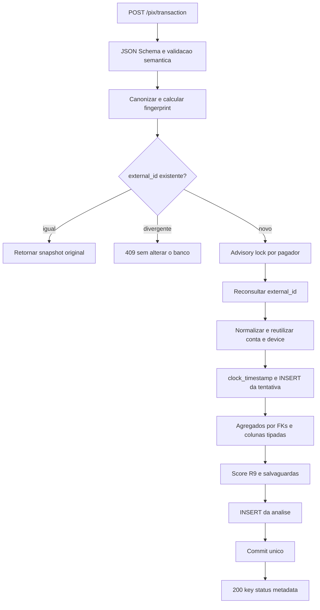
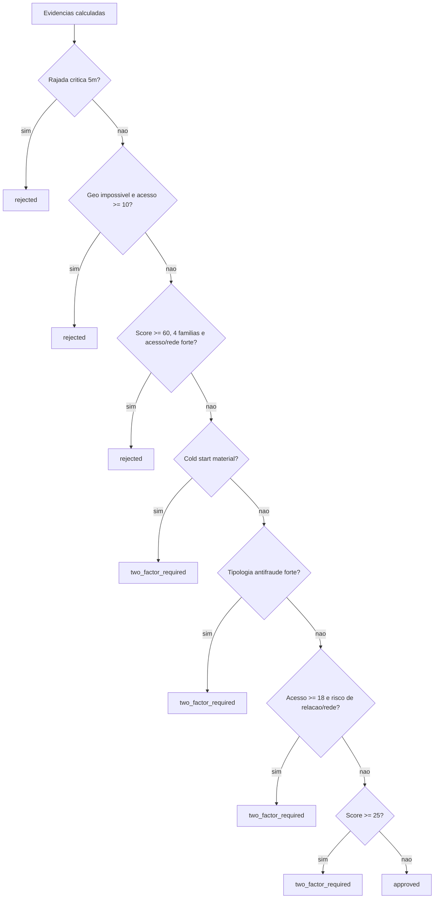
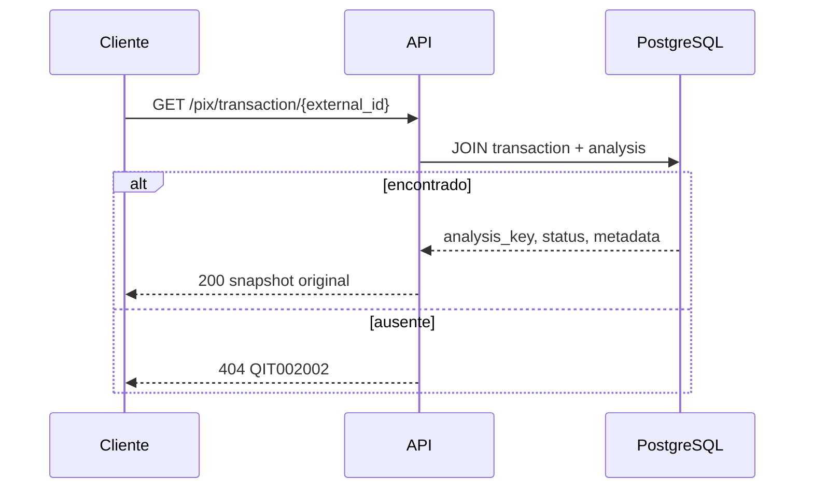

# PIX SENTINEL — fluxos implementados

**Atualizado em:** 18/10/2026
**Política padrão:** `mvp-risk-adaptive-v3-r9`

## 1. Entrada da requisição

Os middlewares executam, de fora para dentro, nesta ordem:

```text
request context → request logger → internal token → session manager → rota
```

O contexto aceita um `X-Request-ID` seguro de até 64 caracteres ou gera um UUID
e devolve o valor na resposta. O logger registra método, caminho, status e
tempo, mas não o corpo. `/` e `/health_check` são públicos; as rotas Pix exigem
`INTERNAL-TOKEN`. A sessão SQLAlchemy é aberta sob demanda e sempre fechada.

## 2. POST novo



Ordem efetiva:

1. O JSON Schema exige a estrutura oficial, `amount` inteiro positivo, strings
   com limites compatíveis com o banco e coordenadas nos intervalos geográficos.
2. O controller rejeita `bool`/float/string em `amount`, ID com `/` ou espaços
   nas bordas, identificadores vazios ou com espaços nas bordas, IP que não
   seja IPv4/IPv6, timestamps sem fuso e números geográficos não finitos.
3. O payload oficial é canonizado e recebe fingerprint SHA-256.
4. Um lookup inicial resolve rapidamente replay ou conflito já persistido.
5. Para um ID novo, o repository adquire `pg_advisory_xact_lock` pela identidade
   do pagador, com `lock_timeout` de 1 segundo, e reconsulta o ID.
6. O documento é normalizado; contas e device são reutilizados ou criados por
   upsert concorrente. `received_at` vem de `clock_timestamp()` após o lock.
7. A tentativa referencia essas entidades e materializa canal, IP e coordenadas
   em tipos próprios. O repository calcula evidências por FKs e colunas tipadas,
   sem extrair contexto histórico do JSONB.
8. A política avalia score, salvaguardas e desafio recomendado.
9. A análise recebe UUID, metadata, evidências, versão da política e horário
   UTC. O controller monta a resposta, faz commit e só então devolve HTTP 200.

## 3. Construção das evidências

As janelas ativas são 1, 5, 15, 60 e 1.440 minutos. Todas usam o relógio do
servidor e a fronteira `(T − W, T]`.

As consultas ligam o evento a `accounts` e `devices` pelas chaves internas.
Canal usa `VARCHAR(32)`, IP usa `INET` e geo usa `DOUBLE PRECISION`. O
`request_payload` integral fica preservado para auditoria e replay, não para
filtrar o histórico.

| Evidência | Base usada |
|---|---|
| Contagem e total tentado nas janelas | Todas as tentativas válidas do pagador, incluindo a atual uma vez. |
| Histórico e repetição da contraparte | Tentativas anteriores; a atual é excluída onde a semântica é “prior”. |
| Device, IP e canal conhecidos | Todas as tentativas anteriores do pagador. |
| Mediana, p90 e hábito noturno | Somente análises anteriores `approved`. |
| Geolocalização anterior | Última tentativa anterior `approved` com geo válida. |
| Fan-out, churn e par em 15 min | Histórico local do pagador nas janelas. |
| Fan-in do recebedor e acesso compartilhado | Histórico local de todos os pagadores, com métricas de janela incluindo a atual. |

Ausência de histórico produz estados `insufficient_history`; não é convertida
automaticamente em fraude. A exceção deliberada é o cold start determinístico:
primeira observação local, conta de origem com menos de 30 dias e valor material
do segmento exige 2FA.

## 4. Score e decisão

Os 29 sinais pertencem a seis famílias. Sinais correlacionados respeitam o teto
da família antes da soma global:

| Família | Teto |
|---|---:|
| exposição/velocity | 60 |
| perfil | 15 |
| relacionamento | 15 |
| acesso | 20 |
| temporal | 25 |
| rede do recebedor | 20 |

O score final é `min(100, soma das famílias)`. A tabela completa de sinais e
limiares está no README. A ordem de decisão é:



As tipologias fortes são: desvio crítico do perfil; desvio de perfil com
destinatário novo; recebedor novo, jovem e material em relação nova; fan-in
crítico; fan-out crítico; e device compartilhado. O último vale isoladamente
para PF/indefinido; em PJ exige também risco de perfil, relacionamento ou rede.
Essas salvaguardas reutilizam os 29 sinais calculados e não somam pontos.

Em 2FA, a recomendação padrão é `push_confirmation`. Somente pagador PF recebe
`facial_liveness`, e apenas quando acesso é pelo menos 18 junto de perfil ≥ 10,
relacionamento ≥ 12 ou temporal ≥ 15. A API recomenda o desafio; não o executa.

## 5. Replay, conflito e concorrência

| Caso | Resultado |
|---|---|
| Mesmo `id` e fingerprint | HTTP 200 com os mesmos `key`, `status` e `metadata`; não conta nova tentativa. |
| Mesmo `id` e fingerprint divergente | HTTP 409; o primeiro registro permanece intacto. |
| Mesmo ID concorrente | A restrição `UNIQUE(external_id)` define o vencedor; após rollback da colisão, o perdedor relê e resolve replay ou conflito. |
| Pix diferentes do mesmo pagador | O advisory lock serializa inserção, consulta histórica e decisão. |
| Resposta perdida após commit | O reenvio recupera a decisão original. |
| Exceção antes do commit | Rollback; tentativa e análise não ficam parcialmente confirmadas. |

O replay não é reavaliado mesmo que a política ativa tenha mudado. Para linhas
antigas sem a versão atual de canonização, o fingerprint é recalculado a partir
do payload preservado para evitar conflito falso.

## 6. GET



O parâmetro é o `id` do POST, não o UUID `key`. O GET não consulta histórico,
não gera outra chave e não recalcula score.

## 7. Falhas reais

| Situação | Efeito |
|---|---|
| Payload Pix inválido | `422` `QIT002001`, antes de persistir. |
| Token ausente ou incorreto | `403` `QIT000002`; nenhuma sessão de banco é aberta. |
| ID reaproveitado com dados oficiais diferentes | `409` `QIT002004`. |
| Política ausente/inválida | `503` `QIT002005`. |
| Exceção inesperada, inclusive falha de banco ou timeout de lock não classificado | Rollback e `500` `QIT000500`. |

O código atual não converte indisponibilidade de banco em `503` específico nem
implementa retry de deadlock/timeout. Também não possui circuito de degradação:
uma falha técnica nunca é transformada em `approved` ou `rejected`.

## 8. Validação automatizada

`scripts/run_all_tests.py` inicia a API internamente e executa as suítes em uma
matriz de políticas contra PostgreSQL isolado. O banco é limpo entre etapas e o
executor falha se houver teste pulado. Última execução registrada: `225 passed,
0 skipped`.
