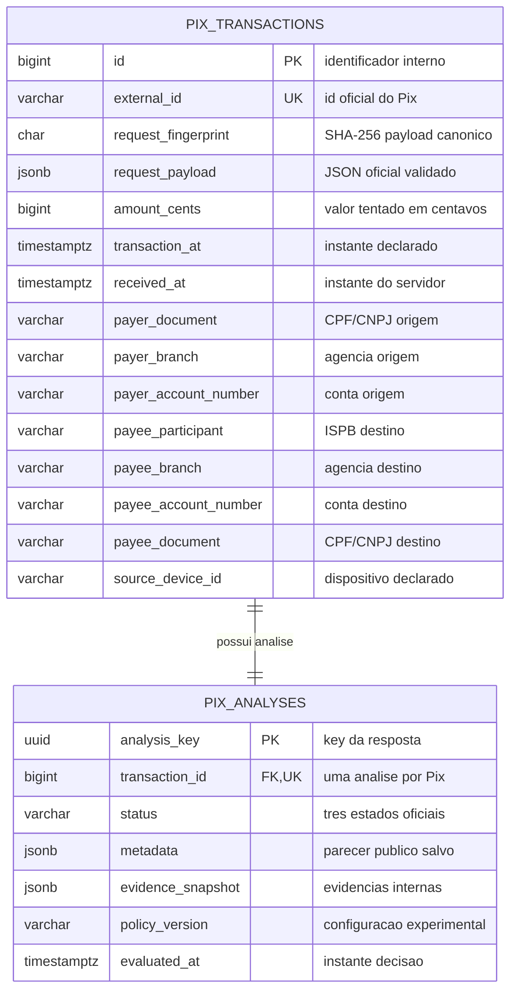

# RFC — PIX SENTINEL: motor antifraude Pix transacional

| | |
|---|---|
| **Time** | João Vitor Miranda Sousa · Mohamad Ahmad Barakat |
| **Data** | 18/10/2026 |
| **Versão** | 1 — proposta para revisão (sem congelamento da política) |

## Contextualização

### Entendendo o problema

Antes de um Pix ser executado, o sistema consumidor precisa receber, em poucos segundos, um **parecer antifraude explicável**: aprovar, solicitar autenticação adicional ou rejeitar por risco. Analisar somente o valor isolado é insuficiente: frequência, montante acumulado e relação com destinatários observados no histórico podem mudar a interpretação, mas também existem comportamentos legítimos parecidos com fraudes. O desafio é equilibrar **tempo, histórico e fricção**, sem presumir fraude comprovada a partir de um sinal fraco.

O serviço deve registrar cada solicitação distinta e permitir recuperar **a decisão original**, mesmo diante de reenvios, concorrência ou mudança posterior de parâmetros. **Não há garantia sobre saldo ou dinheiro movimentado**: o motor apenas opina sobre risco, não verifica fundos, não reserva, não debita e não liquida Pix. Ficam fora desta entrega o MockServer/core bancário, cadastro de contas/dispositivos, limites bancários, frontend, fontes externas, execução de 2FA e modelos de ML treinados.

### Explicando a solução de forma macro

O PIX SENTINEL recebe o JSON oficial da transação, valida e identifica reenvios; para uma solicitação inédita, consulta o **histórico local de tentativas** e extrai sinais simples de **valor, velocity, montante tentado e contraparte observada**. Uma política **determinística, configurável e ainda experimental** transforma essas evidências em `approved`, `two_factor_required` ou `rejected`, com motivo breve em `metadata`. O payload e a análise são gravados atomicamente no banco, para que POST repetido e GET retornem o mesmo parecer. A ausência de histórico não é fraude; o histórico não comprova liquidação nem reputação real do destinatário.

**Alternativas consideradas e descartadas para o MVP:**

- **MockServer com dados bancários** — descartado pelo custo de integração e risco de misturar elegibilidade (saldo/bloqueio) com antifraude. Faria sentido se o escopo futuro incluísse enriquecimento institucional confiável.
- **Score/ML sofisticado e dezenas de regras de uma vez** — descartado por falta de rótulos reais e prazo para calibrar e explicar os efeitos. Seria útil com dados validados, avaliação independente e mais tempo.
- **Decisão apenas por valor fixo** — descartada como solução principal por ignorar o comportamento recente e aumentar falsos positivos/negativos. Permanece como *baseline* simples para comparação.
- **Histórico sem proteção de concorrência** — descartado porque Pix simultâneos do mesmo pagador poderiam receber contagens inconsistentes. Só serviria como protótipo não concorrente.

## Implementação

### Rotas

| Método | Caminho | O que faz | Entrada (campos que importam) | Saídas (status e quando) |
|---|---|---|---|---|
| `POST` | `/pix/transaction` | Valida, consulta histórico, decide e persiste; **idempotente** por `id` externo único + fingerprint canônico do payload | `id`; `amount` inteiro em centavos; `transaction_date` com fuso; dados de origem/destino; `device_id`, `channel`, `ip`; `geolocation` opcional | **`200`** decisão nova ou replay idêntico (`key`, `status`, `metadata`); **`409`** mesmo `id` com conteúdo divergente; **`422`** entrada inválida; **`415`** media type inadequado, se configurado; **`500/503`** falha técnica/BD |
| `GET` | `/pix/transaction/{id}` | Consulta a análise já persistida; leitura naturalmente idempotente | `id` = identificador externo do Pix, **não** o UUID `key` da análise | **`200`** snapshot original (`key`, `status`, `metadata`); **`404`** ID inexistente; **`500/503`** falha técnica/BD |

O `id` externo aceita valores como `pix-000123` (não é UUID); `source_account` **não** possui ISPB/`participant`, enquanto `destination_account.participant` é obrigatório. O `POST` usa **`200` mesmo quando `status = rejected`**: o HTTP descreve sucesso da análise, não aprovação do Pix. Um `400` genérico **não foi definido na proposta ROTAS v1**; erros de campos e estrutura vão para `422`, sujeitos às convenções de tratamento do Base Service. A `key` é criada uma única vez e o `metadata` público não expõe CPF/CNPJ, conta, IP, geolocalização, score detalhado ou limiares. O 2FA é apenas indicado, nunca executado nesta API.

### Banco de Dados (Somente diagrama)

### Fluxos

**POST — caminho feliz (solicitação inédita)**

1. Validar payload oficial, centavos inteiros e timestamps com fuso; normalizar identificadores sem perder zeros/letras; canonizar e calcular fingerprint estável sobre os campos oficiais validados, tratando geo ausente/`null` como equivalentes e timestamps que representam o mesmo instante de forma consistente.
2. Consultar `external_id`. Se ainda não existe, iniciar a transação do BD e proteger a **serialização por pagador** (no PostgreSQL, candidato: *advisory lock* transacional); reconsultar ID no contexto protegido.
3. Inserir a tentativa com `received_at` definido uma vez. Consultar `COUNT`/`SUM` em janela deslizante sobre o mesmo pagador, **incluindo o Pix atual uma única vez**; verificar contraparte previamente observada **excluindo o atual**.
4. Avaliar regras de D (payload), H (histórico) e S (servidor) com parâmetros **provisórios e versionados**; persistir `pix_analyses` com UUID, status, motivos e evidências internas mínimas.
5. Executar **commit único antes de HTTP `200`**. Nenhum débito, reserva ou autenticação é realizado.

**POST — falhas, replay e concorrência**

1. **Mesmo `id` e mesmo fingerprint:** devolver os mesmos `key`, `status` e `metadata` gravados; não reavaliar nem contar a tentativa de novo. **Mesmo `id` e payload diferente:** `409`, sem sobrescrever nada.
2. Em dois POST simultâneos com o mesmo `id`, a restrição `UNIQUE(external_id)` é a autoridade final; a tentativa perdedora faz rollback, relê a vencedora e retorna replay ou `409`. Em dois Pix **distintos** do mesmo pagador, serializar a leitura/agregação para que não usem histórico desatualizado.
3. Falha de consulta, lock, regra ou gravação antes do commit: **rollback integral**, sem Pix/análise órfãos, e resposta técnica `500/503`; nunca transformar falha de infraestrutura em `rejected`. Se a resposta se perder **após o commit**, o replay recupera o parecer original.

**GET — caminho feliz**

1. Receber o `id` externo, consultar `pix_transactions.external_id` e a análise 1:1 correspondente.
2. Retornar `200` com **o snapshot original**, sem novo score, UUID ou leitura do histórico.

**GET — falha**

1. Registro ausente: `404`, sem revelar informação sensível. Banco indisponível: `503` (ou `500` conforme classificação), **não `404` falso**.

> ## Principal desafio
>
> - **Qual é:** conciliar **idempotência e histórico antifraude coerente** quando Pix iguais ou distintos chegam simultaneamente.
> - **Por que é difícil:** `UNIQUE(external_id)` impede duplicar o mesmo Pix, mas **não** impede dois Pix diferentes do mesmo pagador de calcularem velocity e montante sobre uma visão antiga do histórico.
> - **Como o desenho resolve:** uma transação atômica por decisão; unicidade no BD + recuperação do vencedor para replay; serialização por chave canônica do pagador antes da inserção/consulta de histórico (advisory lock transacional **se** o Base Service usar PostgreSQL, a confirmar); testes de concorrência e rollback no ambiente real.

**Duas escolhas ainda exigem aceite de João e Moha antes da implementação dos agregados temporais:** janela candidata **`(T−W, T]`** e `received_at` definido na **admissão serializada após o lock**, em vez de representar literalmente a chegada HTTP. A última opção mantém a ordem de avaliação coerente, mas pode incorporar espera em fila ao relógio da análise. São decisões operacionais **propostas**, não parâmetros de risco congelados. O Codex deve primeiro inspecionar o `bootcamp-base-api` real e adaptar transações, migrações e testes às suas convenções; implementar em fatias pequenas, começando por contrato/persistência/replay e só então regras e concorrência, sem transportar automaticamente os números experimentais da Etapa 4.
